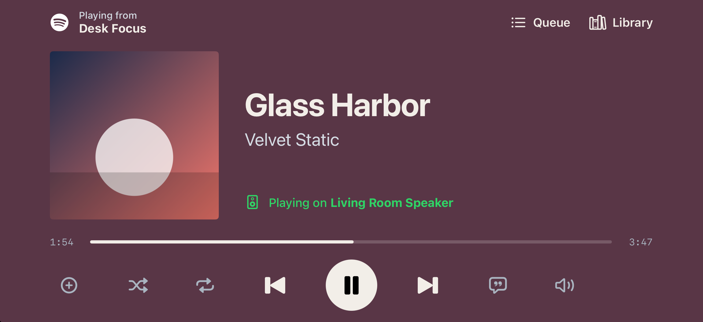
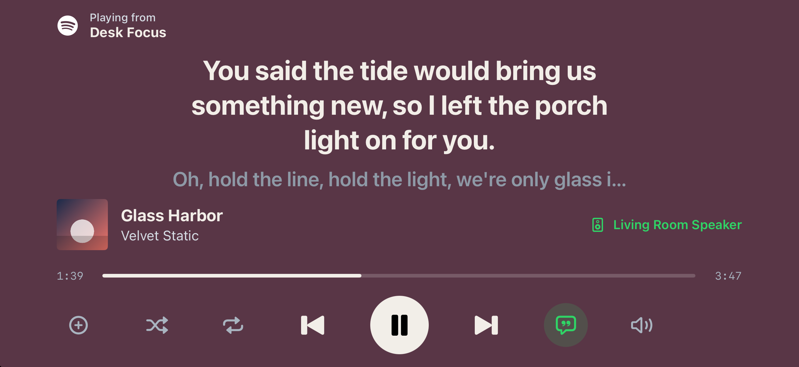
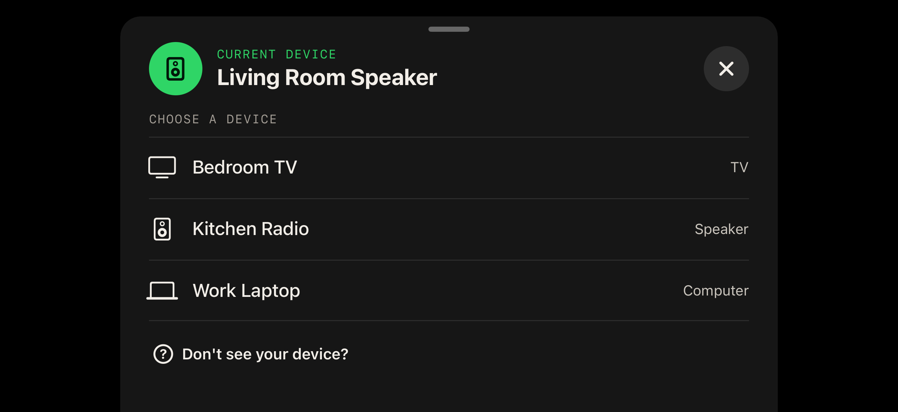
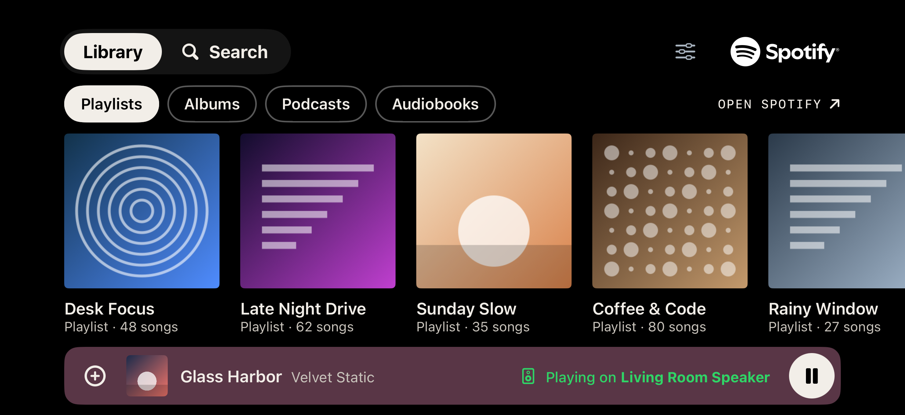
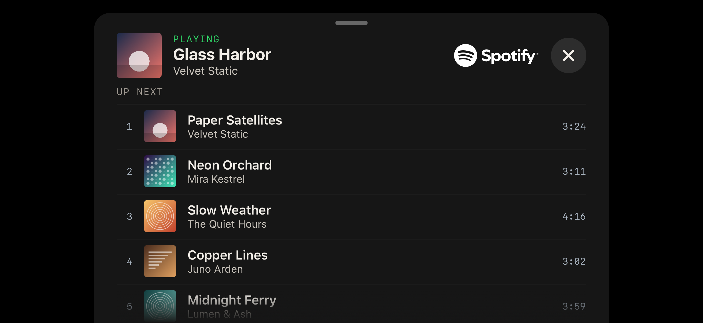
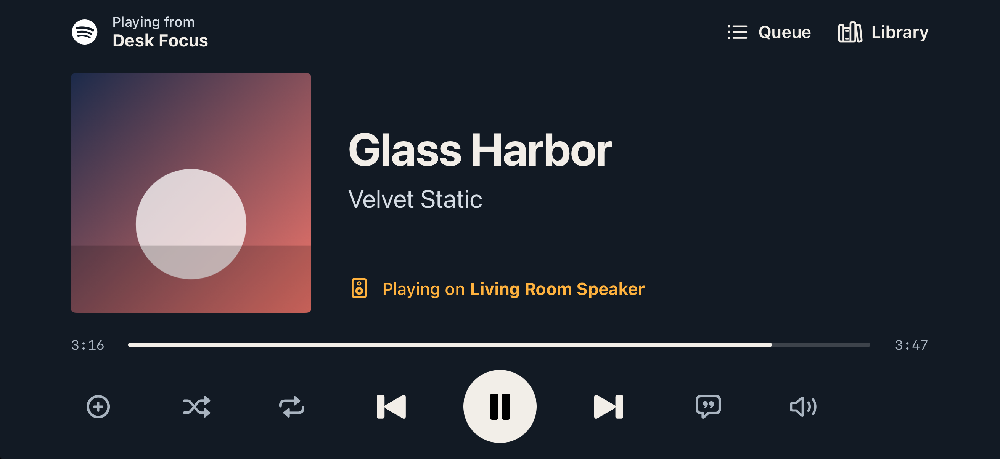
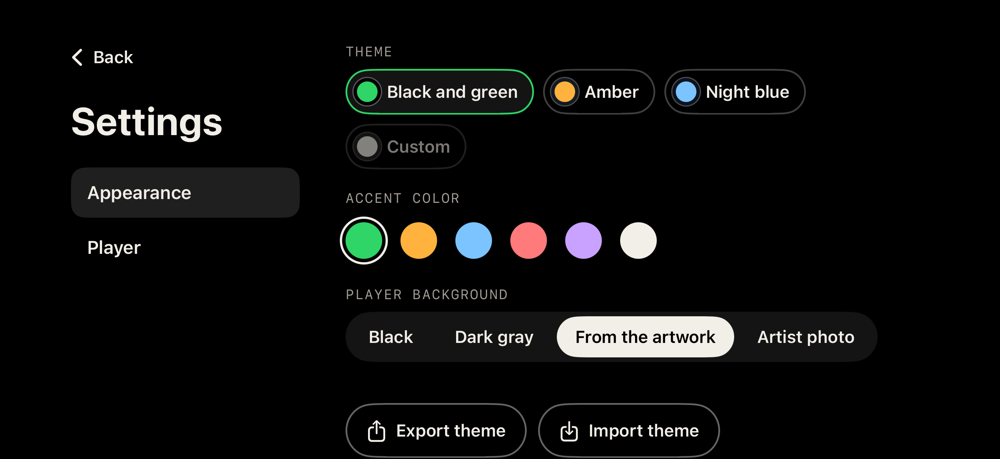

# Nowdeck

**A desk controller for Spotify that runs on your iPhone.**

Prop it up in landscape, plugged in with the screen on, and at a glance you can see what's
playing, control it, and choose which device it plays on.

> Nowdeck is an independent open-source project. It is not affiliated with or endorsed by
> Spotify.

> The app's interface is available in Spanish and English and follows the iPhone's language
> (any other language falls back to English). Screen and setting names below are given in
> English, with the Spanish in parentheses.

## Screenshots



| | |
|---|---|
|  |  |
|  |  |
|  |  |

<sub>Screenshots use made-up tracks, artists, artwork and lyrics from the app's demo mode
(debug builds, `-demoMode YES`).</sub>

## What it does

- Shows what's playing: artwork, track, artist, which playlist or album it comes from and on
  which device, with the background taken from the artwork's color.
- Controls playback: play and pause, previous and next (or −15 s and +15 s for podcasts),
  shuffle, repeat and volume.
- Moves the music from one device to another (computers, speakers, TVs, other phones).
- Shows the playback queue (read-only).
- Browses your library (playlists, albums, podcasts and audiobooks) and plays from there.
- Shows synced lyrics, word by word or line by line, from [LRCLIB](https://lrclib.net).
- Can be customized with themes that are exported and imported as `.nowdeck.json` files.

Nowdeck **does not play audio**: it controls your Spotify Connect devices through the
Spotify Web API. The music plays somewhere else: on the computer, speaker or phone where you
have Spotify open.

## Requirements

- An iPhone with **iOS 16 or later**. The oldest device it has to run on is the iPhone 8 Plus.
- A **Spotify Premium** account: the Web API only accepts playback commands from Premium
  accounts, and the account that creates the developer app must be Premium too.
- Your **own developer app** in the Spotify dashboard (explained below). The app stays in
  *Development Mode*, which allows **up to 5 users** added by hand. Usually each person creates
  their own app and adds themselves as its only user.
- To build: a Mac with **Xcode 27.2** (the version it was built and tested with in the
  simulator; earlier versions that can build for iOS 16 should work) and
  [XcodeGen](https://github.com/yonaskolb/XcodeGen).

## Create your Spotify app

Nowdeck walks you through this the first time you open it, but these are the steps:

1. Go to [developer.spotify.com/dashboard](https://developer.spotify.com/dashboard) with your
   Premium account and accept the developer terms if asked.
2. Tap **Create app**. Use any name and description you like (without "Spotify" in the
   name).
3. Under **Redirect URIs**, paste exactly:

   ```
   nowdeck://callback
   ```

4. Where it asks which API you'll use, check **Web API** and save.
5. Open **Settings** and copy the **Client ID**. You don't need the *Client secret*: Nowdeck
   uses Authorization Code with PKCE, which doesn't need it.
6. If someone else will use your app, add them under **User Management** with their Spotify
   account email (up to 5). If it's just you, you can skip this.

In Nowdeck, paste the Client ID, tap **Connect to Spotify** (*Conectar con Spotify*) and log
in. Nowdeck asks only for these scopes:

| Scope | What for |
|---|---|
| `user-read-playback-state` | See what's playing and on which devices |
| `user-modify-playback-state` | Play, pause, skip, volume, shuffle, repeat and switching devices |
| `user-read-currently-playing` | See the current track |
| `playlist-read-private` | List your private playlists |
| `playlist-read-collaborative` | List your collaborative playlists |
| `user-library-read` | List your saved albums, podcasts and audiobooks |
| `user-read-playback-position` | Know where you are in a podcast episode |
| `user-read-recently-played` | Know what you last listened to, for the background preview in Settings |

If after connecting you see "Spotify won't allow your app" (*Spotify no deja usar tu app*),
check that your account is in **User Management** and that the account that owns the
app has Premium.

## Build

```bash
brew install xcodegen                                   # if you don't have it
cp Config/Local.xcconfig.example Config/Local.xcconfig  # and fill it in (see below)
xcodegen generate                                       # generates Nowdeck.xcodeproj
open Nowdeck.xcodeproj
```

The Xcode project is generated from `project.yml` and is not checked in.

`Config/Local.xcconfig` is not committed to the repository. It holds your signing details:

```
DEVELOPMENT_TEAM = ABCDE12345            // your Apple Team ID
NOWDECK_BUNDLE_ID = com.yourname.nowdeck // optional: your own Bundle ID
```

To run on your iPhone you need a Team ID (a free Apple Developer account is enough) and, if
the account is free, your own Bundle ID. For the simulator, `xcodegen generate` and picking
an iPhone is enough.

Tests (they never connect to Spotify or LRCLIB: everything goes through stubbed responses):

```bash
xcodebuild -scheme Nowdeck -destination 'platform=iOS Simulator,name=<simulator>' test
```

## Gray areas and limits

Things Nowdeck can't do, or that are worth knowing, because of how the Spotify Web API works
in 2026 and because of Spotify's rules:

- **Each user brings their own Client ID.** Since 2026, an app in *Development Mode* allows
  up to 5 users, and *Extended Quota Mode* is only granted to companies with 250,000 monthly
  active users. Spotify neither forbids nor endorses in writing that each user creates their
  own app; it's the only practical way to distribute an open app.
- **Limited quota.** Each developer app has a request quota. When it's exceeded, Spotify
  answers "wait" and Nowdeck polls less often for a while ("SPOTIFY ASKS TO WAIT", *SPOTIFY
  PIDE ESPERAR*, appears).
- **No push updates.** The API doesn't notify changes: Nowdeck polls the state every 3 s
  while playing (10 s when paused), so a change made on another device can take a few
  seconds to show up.
- **Expired Premium.** If the Premium of the account that owns the app expires, the app stops
  working for all its users.
- **Reconnect every 6 months.** The access Spotify grants lasts 6 months from when you
  connect; after that, Nowdeck asks you to connect again.
- **What the API doesn't offer**: editing the queue (removing, reordering or jumping to a
  track), the names of Spotify's editorial and algorithmic playlists (the player just says
  "Spotify playlist"), and playing podcasts or audiobooks from the library (those cards
  open Spotify). Search in *Development Mode* returns at most 10 results per type; the results
  screen isn't built yet.
- **Devices that don't show up.** In practice, the Spotify Connect list only shows devices
  with Spotify open or awake. Some models don't support remote control and appear dimmed.
- **Lyrics from a community database.** Spotify doesn't offer lyrics in its API. Nowdeck gets
  them from [LRCLIB](https://lrclib.net), an open database filled in by its users: lyrics may
  be missing or contain mistakes, and their rights belong to their authors and publishers.
  Also, Spotify's policy forbids combining content from another service with its own, and
  showing third-party lyrics alongside playback has no clear precedent. That's why lyrics can
  be turned off in **Settings → Player → Show lyrics** (*Ajustes → Reproductor →
  Mostrar letras*), and the Settings screen explains where they come from. Nowdeck never uses
  Spotify's internal access to its lyrics.
- **Artist photo as background.** It's off by default. You can turn it on in
  **Settings → Appearance → Player background** (*Ajustes → Apariencia →
  Fondo del reproductor*). The artwork is always shown in full. To fill the background, Nowdeck crops and
  dims the artist's photo, a treatment that may conflict with
  [Spotify's rules on visual content](https://developer.spotify.com/documentation/web-api/reference/get-an-artist).
- **It's not a player.** It doesn't play anything on the iPhone; that's what the Spotify app
  is for.

## Privacy

- **No server of its own and no analytics.** Nowdeck only talks to Spotify (to control
  playback) and to LRCLIB (for lyrics, and only if they're turned on). It sends LRCLIB the
  track's title, artist, album and duration.
- **Your credentials stay on the iPhone**, in the Keychain: the Client ID and the access
  tokens. There is no Client Secret. None of it is stored anywhere else or sent to any other
  service.
- Imported themes are data only: colors and options. They never run anything or load
  anything from the internet.

## Documentation

The project docs are written in Spanish, with an English translation in [`docs/en/`](docs/en/).
If the two differ, the Spanish version wins.

| Document | Spanish original | Contents |
|---|---|---|
| [`docs/en/01-product.md`](docs/en/01-product.md) | [`01-producto.md`](docs/01-producto.md) | Scope, screens and flows |
| [`docs/en/02-design.md`](docs/en/02-design.md) | [`02-diseno.md`](docs/02-diseno.md) | Design tokens and measurements |
| [`docs/en/03-spotify-api.md`](docs/en/03-spotify-api.md) | [`03-spotify-api.md`](docs/03-spotify-api.md) | Authentication, endpoints and errors |
| [`docs/en/04-lyrics.md`](docs/en/04-lyrics.md) | [`04-letras.md`](docs/04-letras.md) | Lyrics with LRCLIB |
| [`docs/en/05-themes.md`](docs/en/05-themes.md) | [`05-temas.md`](docs/05-temas.md) | Theme format |
| [`docs/en/06-compliance.md`](docs/en/06-compliance.md) | [`06-cumplimiento.md`](docs/06-cumplimiento.md) | Spotify's rules and review |
| [`docs/en/07-plan.md`](docs/en/07-plan.md) | [`07-plan.md`](docs/07-plan.md) | Milestone plan |

## Credits

- [LRCLIB](https://lrclib.net): the open, community-driven database of synced lyrics where
  every lyric Nowdeck shows comes from. Thanks to its author and to everyone who contributes
  lyrics.
- [Yams](https://github.com/jpsim/Yams) (MIT license): reads LRCLIB's Lyricsfile format
  (YAML). It's the project's only dependency.
- Spotify and its logo are trademarks of Spotify AB. Nowdeck uses the Spotify Web API and is
  not affiliated with Spotify.

## Contributing

The code lives at [github.com/LaMarCab76/NowDeck](https://github.com/LaMarCab76/NowDeck).
Issues and pull requests are welcome.

## License

[MIT](LICENSE).
